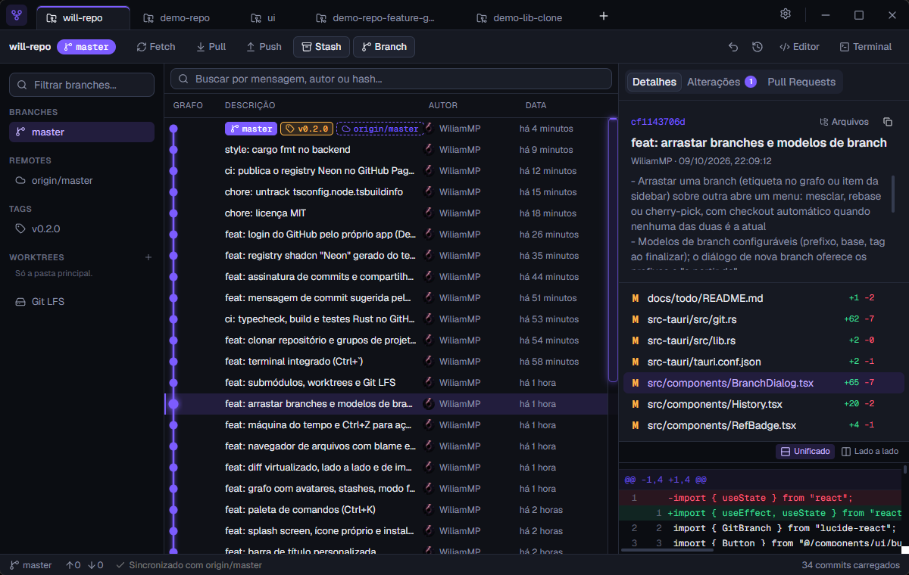

# will-repo

Cliente git para Windows, no estilo do Sourcetree, GitKraken e Fork, com tema **Neon**. Feito com **Tauri 2 + Rust** no backend e **React + TypeScript + shadcn/ui** na interface.



## Instalar

Baixe o `will-repo_x.y.z_x64-setup.exe` na [última versão](https://github.com/WiliamMP/will-repo/releases/latest) e execute. Ele instala só para o seu usuário, sem pedir administrador. Depois disso, o app avisa sozinho quando sai uma versão nova.

> O instalador não tem assinatura de código (certificado pago), então o Windows SmartScreen pode avisar na primeira vez: **Mais informações → Executar assim mesmo**.

Precisa do [git](https://git-scm.com) instalado.

## Recursos

**Histórico e grafo**
- Grafo de commits com lanes coloridas, caminho do HEAD em destaque e minimapa para navegar
- Fotos dos autores, stashes como nós no grafo, modo foco (isolar ou esconder branches)
- Arrastar uma branch sobre outra: mesclar, rebase ou cherry-pick
- Busca por mensagem, autor ou hash

**Alterações e commits**
- Stage, unstage e descarte por arquivo, por trecho ou por linha
- Descartar sem medo: toda alteração descartada pode ser recuperada
- Diff unificado ou lado a lado, virtualizado (arquivos enormes abrem na hora), e diff de imagens
- Assistente de mensagem (Conventional Commits) e mensagem sugerida pelo Claude
- Amend, cherry-pick, revert, tags, assinatura de commits (SSH ou GPG) com selo "Verificado"

**Branches e operações**
- Merge e rebase com resolução de conflitos por bloco ou por arquivo
- Modelos de branch (feature/, fix/, release/, hotfix/) com "Finalizar"
- Máquina do tempo (reflog) e **Ctrl+Z** para desfazer commit, checkout, merge, reset, rebase ou branch excluída

**Arquivos e estrutura**
- Navegador de arquivos de qualquer commit, com blame e histórico do arquivo
- Submódulos, worktrees e Git LFS
- Terminal integrado (Ctrl+`)

**GitHub**
- Pull requests da branch atual, com status do CI; criar PR pelo app
- Clonar a partir dos seus repositórios, links de issues (#123), compartilhar alterações num Gist secreto
- Dashboard com perfil, contribuições e grupos de projetos

**Conforto**
- Paleta de comandos (**Ctrl+K**), configurações no estilo Discord (**Ctrl+,**), fetch automático, várias abas

## Desenvolvimento

Requisitos: [Node 22](https://nodejs.org), [Rust](https://rustup.rs) e git.

```bash
npm ci
npm run tauri dev      # app com recarga automática
npm test               # testes da interface (Vitest + Testing Library)
cd src-tauri && cargo test   # testes do backend (repositórios git reais em pastas temporárias)
npm run build          # typecheck + build da interface
```

**Nova versão:** suba a versão em `package.json`, `src-tauri/Cargo.toml` e `src-tauri/tauri.conf.json`, depois `git tag vX.Y.Z && git push origin vX.Y.Z`. O workflow *Release* compila, assina e publica os instaladores.

## Tema Neon em outros apps

O tema e os componentes animados viram um registry do shadcn, publicado automaticamente:

```bash
npx shadcn add https://wiliammp.github.io/will-repo/r/neon.json
```

## Licença

[MIT](LICENSE)
